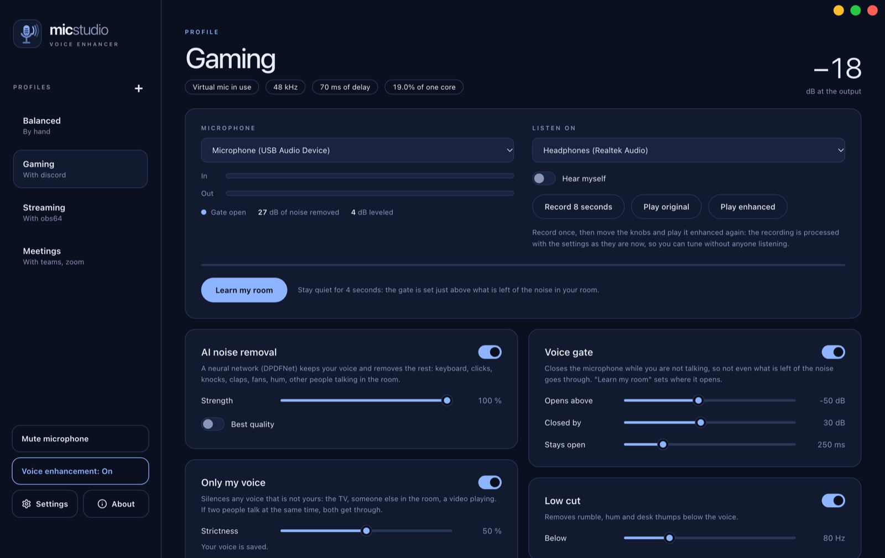
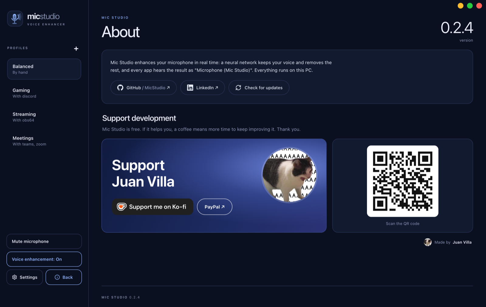
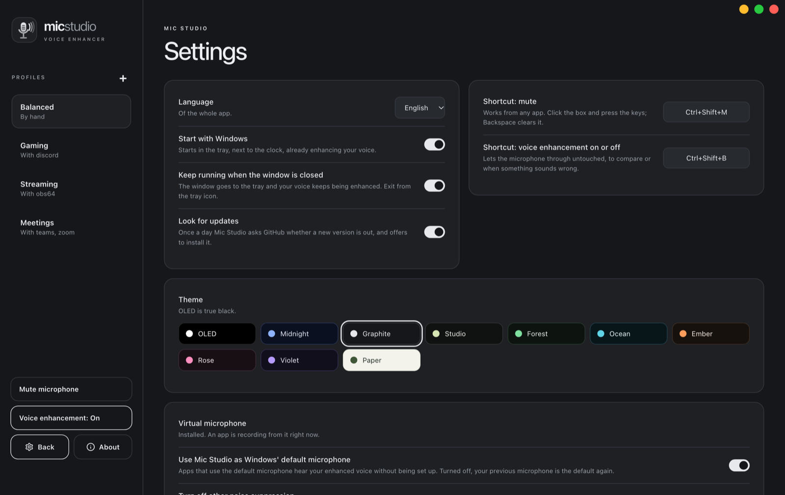
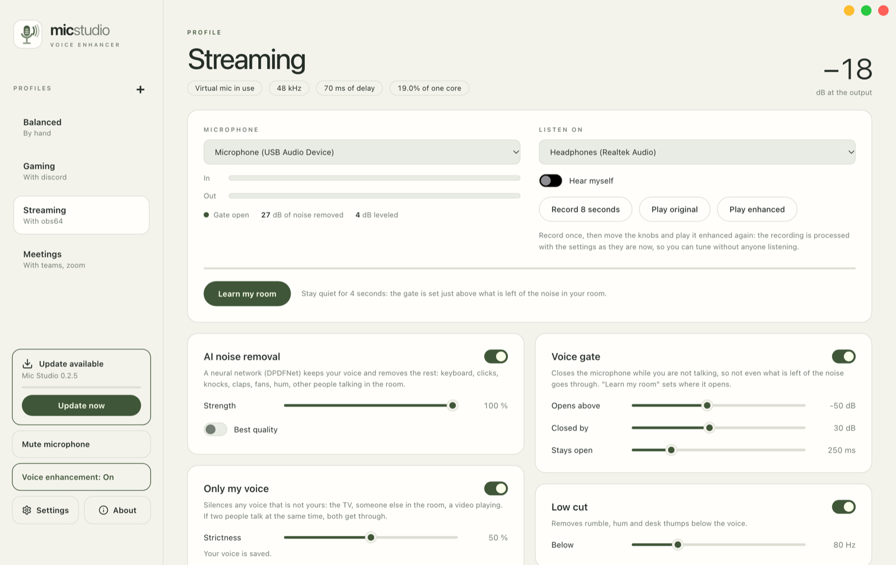
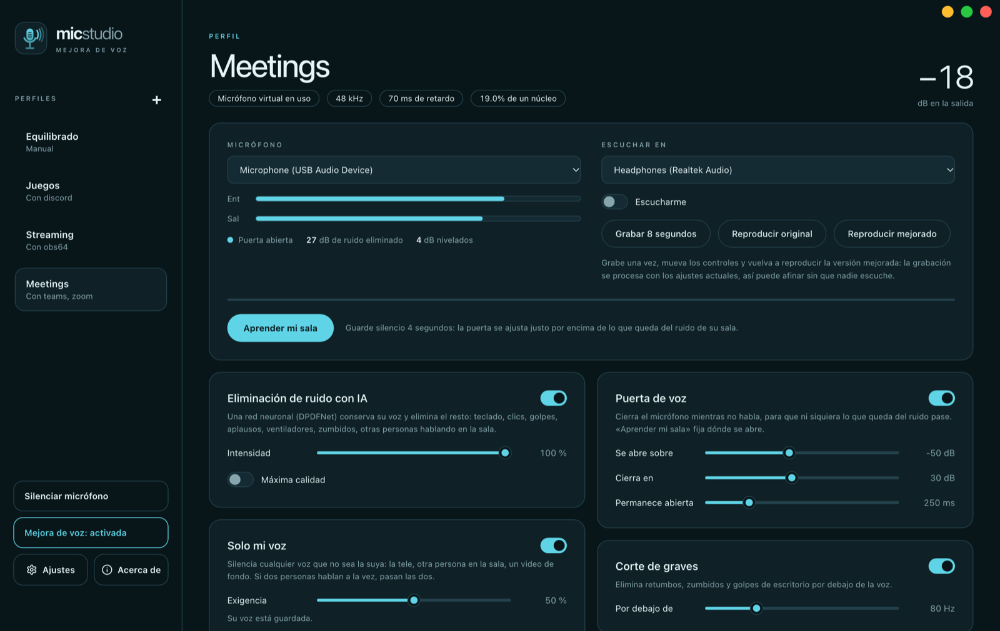

# 🎙️ Mic Studio

**Real-time voice enhancer. Your voice, without the noise — in every app.**

[English](#english) · [Español](#español)

---

## English

Mic Studio cleans your microphone in real time. A neural network keeps your voice and removes the rest — keyboard,
clicks, knocks, claps, fans, hum, other people talking in the room — and Discord, OBS, Zoom, Teams or any other app
hears the result as a microphone called **"Microphone (Mic Studio)"**.

No account. Nothing collected. Your voice never leaves your computer.

### ✨ Features

| | |
|---|---|
| 🧠 **AI noise removal** | A neural network (DPDFNet) removes everything that is not a voice. Light model by default, a "Best quality" model when you want more. |
| 🗣️ **Only my voice** | Record 30 seconds of your voice once; afterwards any other voice (TV, someone in the room, a video) is silenced. When two people talk at the same time, both get through. |
| 🎚️ **A full voice chain** | Voice gate, low cut, tone (body, presence, air), de-esser, leveler and a limiter, each with its own switch and knobs. |
| 🎧 **A real virtual microphone** | Pick "Microphone (Mic Studio)" in any app, like any other microphone. On Windows, no driver of its own: no test mode, Secure Boot stays on. |
| 👤 **Profiles per app** | Balanced, Gaming, Streaming… A profile can switch on by itself while Discord, OBS or Teams is open. |
| 🔁 **Record and compare** | Record 8 seconds, then play the original and the enhanced voice, and tune the knobs without anyone listening. |
| ⌨️ **Shortcuts** | Mute and voice enhancement on/off from any app. |
| ⚡ **Low delay** | About 70 ms in all; the light model uses about a fifth of one processor core. |
| 🎨 **10 themes, English and Spanish** | From OLED black to Paper. |
| 🔄 **Updates in one click** | Checked once a day; every download is verified (size and SHA-256) before it is used. |

### 📊 Measured

Real recordings: a voice mixed with a keyboard or an air conditioner, 3 dB below it.

| Model | Voice (SI-SDR) | Noise in the pauses | Processor |
|---|---|---|---|
| Light (default) | 3.0 → 14.6 dB (keyboard) · 3.0 → 11.8 dB (air conditioner) | 60–64 dB quieter | ~19% of one core |
| Best | 3.0 → 15.3 dB (keyboard) · 3.0 → 12.1 dB (air conditioner) | 63–66 dB quieter | ~52% of one core |

**Only my voice**, with real readers: the other voice in a conversation is 60 dB quieter after 0.7 s, and your own
voice loses under 1 dB.

### 🖼️ Screenshots

<table>
  <tr>
    <td></td>
    <td></td>
  </tr>
  <tr>
    <td align="center">About: version, links and updates</td>
    <td align="center">Settings: themes, startup, shortcuts, updates</td>
  </tr>
  <tr>
    <td></td>
    <td></td>
  </tr>
  <tr>
    <td align="center">Paper theme, with a new version ready to install</td>
    <td align="center">In Spanish, Ocean theme</td>
  </tr>
</table>

### 📥 Install on Windows

1. Download `MicStudioSetup-<version>.exe` from the [latest release](https://github.com/xxWismaxx/MicStudio-releases/releases/latest).
2. Run it. Windows asks for administrator rights. The installer is not code-signed, so SmartScreen may warn the first
   time: choose **More info**, then **Run anyway**.
3. In Discord, OBS, Zoom or any other app, pick **"Microphone (Mic Studio)"** as the microphone.

Needs Windows 10 (version 1903 or later) or Windows 11, 64-bit.

### 🍎 macOS

The Mac version (Apple Silicon, macOS 14 Sonoma or later) arrives with the next release as `MicStudio-<version>.dmg`,
next to the Windows installer:

1. Open the `.dmg` and drag **Mic Studio** onto **Applications**.
2. Open it. The app is not notarized by Apple, so the first time go to **System Settings › Privacy & Security** and
   click **Open Anyway**.
3. Allow the microphone, then accept the virtual microphone and type your Mac's password once.

On the Mac the real microphone opens only while an app records from "Mic Studio" (a call in Teams, Zoom or Discord).

> [!TIP]
> In the app that uses the microphone, turn its own **noise suppression**, **echo cancellation** and **automatic
> gain** off: two cleaners in a row sound worse than one.

### 🔄 Updates

Once a day Mic Studio looks here for a new version and offers to install it; your settings are kept. The switch
**Look for updates** in Settings turns that off, and **Check for updates** on the About page looks right away. Asking
GitHub for a new version is the only thing Mic Studio does on the internet.

### 💬 Problems and ideas

[Open an issue](https://github.com/xxWismaxx/MicStudio-releases/issues) and say which version you have (it is on the
About page), what you did and what happened.

### ☕ Support

Mic Studio is free. If it helps you, a coffee means more time to keep improving it:
[Ko-fi](https://ko-fi.com/juancarlosvillarivera) ·
[PayPal](https://www.paypal.com/donate/?business=jcarlos.villa.rivera%40gmail.com).

---

## Español

Mic Studio limpia tu micrófono en tiempo real. Una red neuronal conserva tu voz y quita el resto — teclado, clics,
golpes, aplausos, ventiladores, zumbidos, otras personas hablando en la sala — y Discord, OBS, Zoom, Teams o cualquier
otra aplicación escucha el resultado como un micrófono llamado **"Microphone (Mic Studio)"**.

Sin cuenta. Sin recopilar nada. Tu voz nunca sale de tu computadora.

### ✨ Funciones

| | |
|---|---|
| 🧠 **Eliminación de ruido con IA** | Una red neuronal (DPDFNet) quita todo lo que no es voz. Modelo ligero por defecto y un modelo de "Mejor calidad" cuando quieres más. |
| 🗣️ **Solo mi voz** | Graba 30 segundos de tu voz una vez; después cualquier otra voz (la tele, alguien en la sala, un video) se silencia. Si dos personas hablan a la vez, pasan las dos. |
| 🎚️ **Cadena de voz completa** | Puerta de voz, corte de graves, tono (cuerpo, presencia, aire), de-esser, nivelador y limitador, cada uno con su interruptor y sus controles. |
| 🎧 **Un micrófono virtual de verdad** | Elige "Microphone (Mic Studio)" en cualquier aplicación, como cualquier otro micrófono. En Windows, sin driver propio: sin modo de prueba y con Secure Boot activado. |
| 👤 **Perfiles por aplicación** | Equilibrado, Juegos, Streaming… Un perfil puede activarse solo mientras Discord, OBS o Teams están abiertos. |
| 🔁 **Graba y compara** | Graba 8 segundos, escucha la voz original y la mejorada, y ajusta los controles sin que nadie te escuche. |
| ⌨️ **Atajos** | Silenciar y activar o desactivar la mejora de voz desde cualquier aplicación. |
| ⚡ **Poco retardo** | Unos 70 ms en total; el modelo ligero usa más o menos una quinta parte de un núcleo. |
| 🎨 **10 temas, inglés y español** | Del negro OLED al Papel. |
| 🔄 **Actualizaciones con un clic** | Se buscan una vez al día; cada descarga se verifica (tamaño y SHA-256) antes de usarse. |

### 📊 Medido

Grabaciones reales: una voz mezclada con un teclado o un aire acondicionado, 3 dB por debajo de ella.

| Modelo | Voz (SI-SDR) | Ruido en las pausas | Procesador |
|---|---|---|---|
| Ligero (por defecto) | 3.0 → 14.6 dB (teclado) · 3.0 → 11.8 dB (aire acondicionado) | 60–64 dB más bajo | ~19% de un núcleo |
| Mejor | 3.0 → 15.3 dB (teclado) · 3.0 → 12.1 dB (aire acondicionado) | 63–66 dB más bajo | ~52% de un núcleo |

**Solo mi voz**, con lectores reales: la otra voz de una conversación queda 60 dB más baja a los 0.7 s, y tu propia voz
pierde menos de 1 dB.

### 📥 Instalar en Windows

1. Descarga `MicStudioSetup-<versión>.exe` de la [última versión](https://github.com/xxWismaxx/MicStudio-releases/releases/latest).
2. Ejecútalo. Windows pide permisos de administrador. El instalador no está firmado, así que SmartScreen puede avisar
   la primera vez: elige **Más información** y luego **Ejecutar de todas formas**.
3. En Discord, OBS, Zoom o la aplicación que uses, elige **"Microphone (Mic Studio)"** como micrófono.

Necesita Windows 10 (versión 1903 o posterior) o Windows 11, de 64 bits.

### 🍎 macOS

La versión para Mac (Apple Silicon, macOS 14 Sonoma o posterior) llega con la próxima versión como
`MicStudio-<versión>.dmg`, junto al instalador de Windows:

1. Abre el `.dmg` y arrastra **Mic Studio** a **Aplicaciones**.
2. Ábrelo. La app no está notarizada por Apple, así que la primera vez ve a **Ajustes del Sistema › Privacidad y
   seguridad** y pulsa **Abrir igualmente**.
3. Permite el micrófono, acepta el micrófono virtual y escribe la contraseña de tu Mac una vez.

En Mac el micrófono real solo se abre mientras una aplicación graba desde "Mic Studio" (una llamada en Teams, Zoom o
Discord).

> [!TIP]
> En la aplicación que usa el micrófono, desactiva su propia **supresión de ruido**, **cancelación de eco** y
> **ganancia automática**: dos limpiadores seguidos suenan peor que uno.

### 🔄 Actualizaciones

Una vez al día Mic Studio busca aquí una versión nueva y ofrece instalarla; tus ajustes se conservan. El interruptor
**Buscar actualizaciones** en Ajustes lo desactiva, y **Buscar actualizaciones** en la página Acerca de busca al
momento. Preguntarle a GitHub por una versión nueva es lo único que Mic Studio hace en internet.

### 💬 Problemas e ideas

[Abre un issue](https://github.com/xxWismaxx/MicStudio-releases/issues) y di qué versión tienes (está en la página
Acerca de), qué hiciste y qué pasó.

### ☕ Apoyo

Mic Studio es gratuito. Si te resulta útil, un café significa más tiempo para seguir mejorándolo:
[Ko-fi](https://ko-fi.com/juancarlosvillarivera) ·
[PayPal](https://www.paypal.com/donate/?business=jcarlos.villa.rivera%40gmail.com).

---

This repository holds only the releases of Mic Studio; the source code is not public. ·
Este repositorio solo contiene las versiones publicadas de Mic Studio; el código fuente no es público.

© 2026 Juan Carlos Villa. All rights reserved. Third-party components and their licenses:
[THIRD_PARTY_NOTICES.md](THIRD_PARTY_NOTICES.md).

